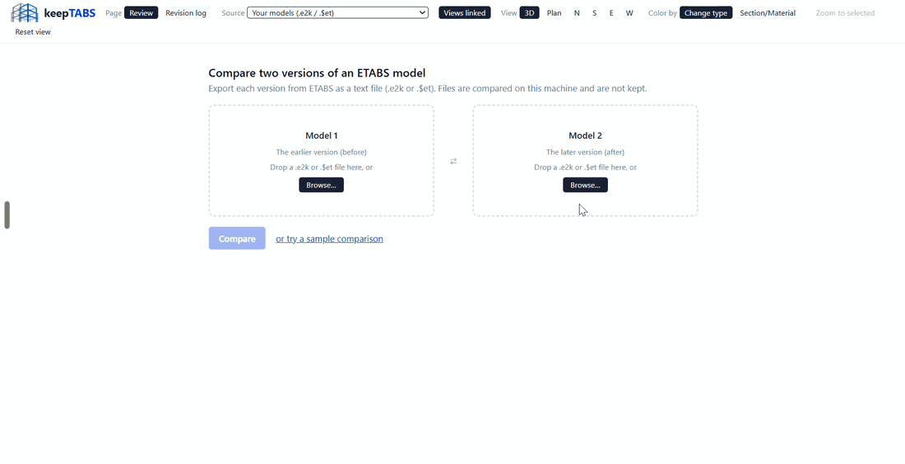
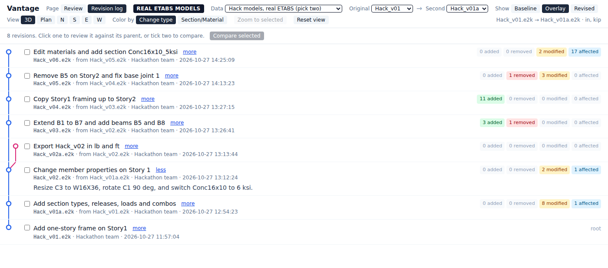

# For NCSEA 2026 Hackathon, so its a bit chaotic



*keepTABS loading two ETABS exports and showing what changed.*

# keepTABS (get it, like ETABS...)

Visual diff for ETABS models. Point it at two exports of the same model (`.e2k`, or the `.$et` ETABS writes on save) and it shows what changed: members added, removed, moved, or modified in a 3D view, plus tables for materials, sections, load patterns, cases, combos, and the rest.

# Quick Start

Run `just ui` from the repo root (needs node and npm, plus Python 3.9+ for the engine). It installs the app's dependencies if they're missing or older than the lockfile, starts the dev server at http://127.0.0.1:5173, and tries to open a browser (under WSL it may not, so open the printed URL). Ctrl+C stops it.

That's keepTABS, the team's React app in `frontend/src/`. It has two pages, picked with **Page** in the top bar:

- **Review**: the 3D view, change table, story strip and details panel for one comparison. The **Source** dropdown picks the data: **Your models** (the default, opens on a start screen where you drop a Model 1 and a Model 2 `.e2k` / `.$et`, diffed by the engine on this machine through the dev server), a diff JSON from the engine, two of the hackathon models (picked with Model 1 and Model 2, starting on `Hack_v01` to `Hack_v01a`; the start screen's **or try a sample comparison** link goes here), or the seeded synthetic demo.
- **Revision log**: every hackathon model version, newest first, with a branch graph like `git log --graph` and change counts per version. Click a row to review it against its parent, or tick two to compare them. **Add version** takes a new `.e2k`, suggests a parent from its save log, scrubs Windows user folders out of the file's path lines, writes it into `frontend/demo_viewer/models/`, appends it to `revisions.json` and regenerates the diffs. It doesn't commit anything (see egit below).



The engine is stdlib Python only. The 3D views load three.js, and the HTML demo viewer pulls it from a CDN, so that one needs internet. Everything serves on 127.0.0.1 only, so model files stay on your machine.

# Recipes

With [just](https://github.com/casey/just), from the repo root:

| Recipe | What it does | What you see |
| --- | --- | --- |
| `just` | lists the recipes | the list |
| `just ui` | installs if needed and starts the React app | keepTABS at http://127.0.0.1:5173 |
| `just demo` | serves the HTML demo viewer on the eight hackathon models in `frontend/demo_viewer/models/` | Before/After dropdowns (opens on `Hack_v01` to `Hack_v01a`), pick any pair |
| `just view before.e2k after.e2k` | diffs two files of your own | the HTML viewer on the result |
| `just csv before.e2k after.e2k changes.csv` | diffs two files, writes one CSV row per change | the status counts in the terminal |
| `just example` | serves the HTML viewer on the bundled made-up example diff | a small 3-story steel model in every status |
| `just egit ...` | runs egit (see below) | git-style output |
| `just typecheck` | runs pyright in strict mode on `backend/diff_engine/` | type errors, if any |
| `just test` | type-checks, then runs the diff engine tests and the React app's tests | the unittest and vitest results |

The HTML viewer recipes print a URL and try to open your browser. Ctrl+C stops the server. `just typecheck` and `just test` need pyright on your PATH (`npm install -g pyright` or `pip install pyright`); it's a dev tool only. `just test` also needs node and npm, and installs the app's dependencies if they're missing.

In the React UI (`just ui`), load a real model comparison and choose **Append Excel Log** to download an `Analysis Register - v??.xlsx`. The first use starts from the included blank register template; later appends ask you to select the latest downloaded workbook so hand-edited cells are retained. The UI remembers logged model pairs in this browser and offers reject, replace, or add-as-new when a pair is repeated.

Without `just`, run the engine from `backend/` (or set `PYTHONPATH=backend` from the root):

```
python3 -m diff_engine before.e2k after.e2k -o diff.json     # JSON diff
python3 -m diff_engine before.e2k after.e2k --view           # open the HTML viewer on it
python3 -m diff_engine before.e2k after.e2k --csv changes.csv --summary
python3 -m diff_engine.serve                                 # same as just demo
python3 -m diff_engine.demo_diffs                            # rediff every pair of the hackathon models
python3 -m diff_engine ../fixtures/demo/before.e2k ../fixtures/demo/after.e2k --view   # the seeded synthetic pair
```

Rerun `demo_diffs` after changing a model by hand (a test fails if `frontend/demo_viewer/diffs/` is stale; Add version and `egit add` do it for you). The React app's own commands run from `frontend/`: `npm ci`, `npm run dev`, `npm test` (vitest), `npm run build` (into `frontend/dist/`).

`--tolerance` (node match, in inches, defaults to the before file's `MERGETOL`, or 0.1 in) and `--move-tolerance` (default 36 in, `0` turns moves off) tune matching.

# egit

There's also a little easter egg: `egit`, git for model versions. It works on the same history as the Revision log (`frontend/demo_viewer/models/revisions.json`). Run it as `./egit` from the repo, or `just egit` from anywhere in it.

```
./egit log                         # the history with branch lanes and change counts
./egit show Hack_v03               # a version's message and its diff against its parent
./egit diff Hack_v01 Hack_v06 --stat
./egit add new.e2k -m "Add a brace on Story2"   # same rules as the Add version form
./egit status                      # versions added but not committed yet
./egit push                        # commit just the history files and git push
```

`./egit --help` and `./egit <command> --help` have the rest.

To run it bare as `egit` from any folder, symlink it onto your PATH once from the repo root: `ln -s "$PWD/egit" ~/.local/bin/egit`. It finds the history from its own location, so the symlink works anywhere.

# How It Compares Models

- Both files are normalized to kip and inch, so the same model saved in different units diffs clean (`Hack_v02a` is `Hack_v02` in lb and ft).
- Elements match by geometry relative to their level: same level, plan X/Y and offset within the tolerance. Labels are never used for matching (ETABS relabels on redraw).
- A story elevation change is reported once in the stories table. Members on that story aren't flagged just because the story moved.
- A removed and an added frame of the same type are linked as one move when neither end travelled more than 36 in. Separately, whatever the travel, they're linked when they're colinear, overlap, and have identical assigns (a beam extended, shortened, or slid along its line). That colinear link is one-to-one, so a beam split in two or two merged into one isn't linked.
- Renames are caught both ways. A matched element whose label changed gets a `label` change marked `renamed`. A definition (material, section, load pattern, case, combo, and the other tables) that was removed and re-added under a new name with identical properties is reported once as renamed instead of removed plus added, as long as the pairing is unambiguous. References to it compare by identity, so a rename alone doesn't show up as a section reassignment on every member.
- Editing a section or material marks every member using it as "affected", with a `via` list saying which definition did it. The viewers highlight them in 3D.

Full details are in [`backend/diff_engine/README.md`](backend/diff_engine/README.md).

# What It Catches

Against the team's 17-row change list:

| Row | Change | Status |
| --- | --- | --- |
| 1 | Geometry: members, nodes, shells added / removed / moved, story elevation | caught |
| 2 | Section reassigned | caught |
| 3 | Section definition edited | caught |
| 4 | Material edited | caught |
| 5 | Property modifiers | caught |
| 6 | Releases, offsets, insertion point, local axis | caught |
| 7 | Nodes modified | caught |
| 8 | Supports and springs | caught |
| 9 | Applied loads | caught |
| 10 | Additional mass | deferred (keyword guess only, never seen in a real export) |
| 11 | Mass source | caught |
| 12 | Load patterns, auto seismic and wind inputs | caught |
| 13 | Load cases, P-delta | caught |
| 14 | Combos | caught |
| 15 | Walls and slabs added / removed | caught |
| 16 | Diaphragms | caught |
| 17 | Response spectrum and time history functions | caught |

Every change carries its row and an `affects` tag (geometry, stiffness, mass, load), and the HTML viewer filters on both. Anything outside the list comes through with `row: null` rather than being dropped.

# Repo Layout

| Folder | What's in it |
| --- | --- |
| `backend/diff_engine/` | the working engine: parser, matching, diff, CSV report, HTML viewer server, egit (stdlib Python, strict pyright) |
| `frontend/src/` | keepTABS, the React app `just ui` runs (Review and Revision log pages) |
| `frontend/compareE2k.ts`, `frontend/saveRevision.ts` | the dev-server routes behind upload and Add version (they call the engine) |
| `frontend/demo_viewer/` | the HTML demo viewer (one static file with three.js), the hackathon models, `revisions.json`, and their precomputed diffs |
| `fixtures/demo/` | the seeded synthetic before/after pair, its diff, CSV, and generator |
| `egit` | the egit launcher |
| `docs/` | the demo GIF, and the original hackathon plan in `docs/history/` |

# Output

- JSON contract: [`frontend/demo_viewer/contract.ts`](frontend/demo_viewer/contract.ts) is the source of truth, explained field by field in [`frontend/demo_viewer/CONTRACT.md`](frontend/demo_viewer/CONTRACT.md). The engine builds it through matching `TypedDict`s in `backend/diff_engine/contract.py`.
- CSV: one row per change with columns `table, key, kind, subtype, label, story, status, field, before, after, affects, row, via` (`COLUMNS` in `backend/diff_engine/report.py`). A rename row has `status` `renamed`.

# Model Files

Real client models never go in the repo (`.gitignore` blocks `.e2k`, `.$et`, `.edb` and friends). The only models committed are the approved hackathon models in `frontend/demo_viewer/models/` and the synthetic ones under `fixtures/`.

# Links

[Miro](https://miro.com/welcomeonboard/UlBzSDVtUjZIMHlLU2pQRjkzNlZZSTJhUXhlTlkvSlJwdjU1WmNMTFk2MXdUVDNVeEp3Vk1sd3p3ZjFzSmRhS3orYmtFTWhVWnQrQmhWeUVrRjRDemZhdkJDbDhrdTFuNzZYL1ZUOXdGZDBJZittcG1pVHBta0U2MllVc2FpR3dBd044SHFHaVlWYWk0d3NxeHNmeG9BPT0hdjE=?share_link_id=573872713675)
