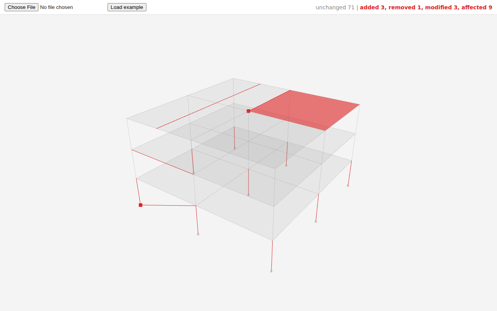

# etabs-diff Viewer

A simple 3D viewer for the output of the etabs-diff engine. The engine compares two ETABS exports of the same model and writes a JSON diff. This page draws every element in that diff: unchanged elements in transparent gray, anything that changed (added, removed, modified, or affected) in red.

It's one static HTML file. There's no install and no build step. It loads three.js 0.160.0 from the jsDelivr CDN, so it needs internet access.

## Files

| File | What it is |
|---|---|
| `index.html` | The whole viewer. |
| `contract.ts` | The exact shape of the diff JSON. This is the source of truth. |
| `CONTRACT.md` | The same contract explained field by field. Start here. |
| `example-diff.json` | A made-up 3-story, 2x2-bay steel building with elements in every status, so you can work on the viewer without the engine. |

## Opening It

Either works:

- **From disk:** double-click `index.html`. Load a diff with the file picker or by dragging the JSON onto the page. The "Load example" button can't read neighboring files from a `file://` page (browsers block it), so it opens the picker and you pick `example-diff.json`.
- **From a static server** (makes "Load example" one click): from this folder run `python -m http.server 8000` and open http://localhost:8000.

Controls: left drag to orbit, right drag to pan, scroll to zoom. The top right shows the counts per status from the diff's `summary`.

## Loading a Real Engine Output

Run the engine on two `.e2k` files and load the JSON it writes, the same way you'd load the example. Anything that follows `contract.ts` will draw. If the page says it's not an etabs-diff output, the file is missing the `elements` array.

The engine is still being built on a separate branch, so until it lands, `example-diff.json` is the stand-in. If you change the example, keep it valid against `contract.ts` and keep `summary` matching the element counts.

## How It Draws

- `frame` elements are lines between their two `geometry` points.
- `area` elements are filled faces through their corners (fan triangulated, which is right for convex shapes).
- `point` elements are small square markers.
- `status === "unchanged"` is gray and transparent. Every other status is red.
- Coordinates are in inches, Z up, straight from `geometry`. The camera frames the whole model on load.

## Follow-Up Ideas

Not built yet, in rough priority order:

1. Click an element to see its `label`, `story`, `status`, `changes`, and `via`.
2. Separate colors per status (e.g. green added, red removed, orange modified, yellow affected), with toggles to hide each.
3. Story filter or isolate, using `stories` and each element's `story`.
4. A panel for `tables` (materials, sections, load patterns that changed).
5. Thicker lines for red frames (WebGL lines are always 1px; three.js `Line2` fixes this).
6. Proper triangulation for non-convex areas (L-shaped slabs or walls) with `THREE.ShapeUtils`.
7. Warn when `schemaVersion` isn't `"0.1"`.
